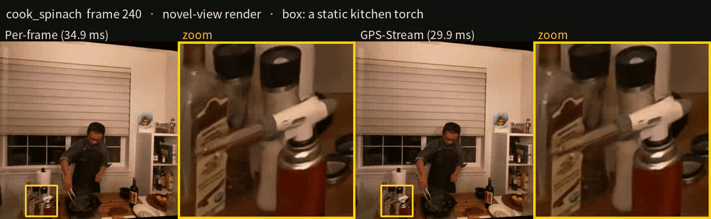

# GPS-Stream

GPS-Stream turns [GPS-Gaussian+](https://github.com/YaourtB/GPS_plus), a feed-forward model that reconstructs a scene as pixel-wise 3D Gaussians
from one rectified stereo pair, into a streaming model for stereo video. Instead of reconstructing every frame from scratch, it updates only the
parts of the scene that changed since the last frame and keeps the rest. This makes it real-time and temporally consistent: static content no
longer flickers, because it is not re-estimated every frame.

**29.8 ms/frame on an RTX 3090 (vs. 35.0 ms per-frame) at −0.16 dB PSNR, with 30% better temporal consistency (tOF 0.230 vs. 0.328).**



## Quick start

Tested with Python 3.10, PyTorch 2.0.1 (CUDA 11.8), TensorRT 10.13, RTX 3090.

```bash
conda env create --file enviroment.yml && conda activate gps_plus
git clone https://github.com/graphdeco-inria/gaussian-splatting --recursive
pip install -e gaussian-splatting/submodules/diff-gaussian-rasterization
pip install tensorrt-cu11==10.13.0.35 onnx lpips
```

Download the pretrained weights (<!-- TODO: link -->) into `experiments/` and prepare the DyNeRF test scenes in `GPS_plus_data/test/` ([docs/training.md](docs/training.md#data)), then build the TensorRT engines for your GPU and render:

```bash
export PYTHONPATH=.
python bench_trt_sparse.py --build --only enc
python build_sparse_trt.py --teacher experiments/patch_sparse_ft128h4_rc4/ckpt/step8000.pth \
    --out trt/sparse_ft128h4_rc4 --patch 128 --halo 4 --reg_margin 4
python test_patch3.py --exp demo --mask stss --ckpt experiments/stss_patch64/ckpt/step4000.pth \
    --patch 128 --exec sparse_trt --halo 4 --reg_cells 4 --reg_mode crop \
    --engine experiments/gps_plus_dynerf_jit2_1007/trt/sparse_ft128h4_rc4 \
    --teacher experiments/patch_sparse_ft128h4_rc4/ckpt/step8000.pth
```

Use `--exec sparse` for PyTorch, or `--exec perframe` without `--teacher` for the original network.

## Your own stereo video

<!-- TODO: input format, resolution constraints -->

Released weights are fine-tuned on DyNeRF only. For other scenes, fine-tuning is recommended; see [docs/training.md](docs/training.md).

## Method

Per-frame reconstruction spends most of its compute on content that did not change, and re-estimating that content every frame makes it
flicker. GPS-Stream keeps the original network and its quality, and changes only what is computed each frame.

1. **Start frame.** The first frame runs the full per-frame network. It fills the state that later frames reuse: attention and context
   features, depth, and the Gaussian maps of both views.
2. **Change selection.** A lightweight selector (STSS, about 10k parameters) compares each 1/8-resolution encoder cell with that cell's
   features at its last update, and marks the cells that changed. Comparing against the last update rather than the previous frame lets slow
   changes accumulate until they are picked up.
3. **128 px tiles.** Changed cells are grouped into 128 px tiles (16×16 cells), and only these tiles are recomputed. Fixed-size tiles let every
   changed region run as one batch of equal-size crops, which is what the TensorRT engines are built for. On DyNeRF the updated tiles cover
   about 20% of the image.
4. **Context border.** Each tile is computed together with a 32 px (4-cell) border read from the stored maps, so the convolutions and the eight
   recurrent depth updates see their neighbourhood. Only the tile core is written back.
5. **Attention for tile cells only.** Epipolar attention runs only for the tile cells, but each still attends to the full row of the other view,
   so the matching range is the original one.
6. **Frozen normalisation statistics.** A crop cannot compute whole-image normalisation statistics, so the crop stages use the start frame's
   statistics of each view. A recomputed tile then stays consistent with the stored maps around it.
7. **Fine-tuning for the tile condition.** Crops see a zero-padded border and frozen statistics, which the original network was not trained
   for. Fine-tuning it under this condition (8000 steps) keeps quality within 0.16 dB of the per-frame network.
8. **TensorRT.** The encoder, the crop stages (dynamic batch) and the row-wise attention run as fp16 engines. The normalisation statistics are
   an engine input, so one set of engines serves every sequence.

## Performance

DyNeRF, 4 scenes × 3 sequences, 948 novel-view frames. Inference time on an RTX 3090, excluding rendering (~7 ms).

| Configuration | PSNR / SSIM / LPIPS | tOF ↓ | TensorRT fp16 | PyTorch fp32 |
|---|---|---|---|---|
| Per-frame (original) | 29.31 / 0.9236 / 0.0810 | 0.328 | 35.0 ms | 152.4 ms |
| **GPS-Stream** | 29.15 / 0.9208 / 0.0839 | 0.230 | 29.8 ms | 118.0 ms |

tOF ([TecoGAN](https://arxiv.org/abs/1811.09393)) is the difference between the optical flow of consecutive rendered frames and that of the
ground truth, a measure of temporal consistency; lower is better. Full results and protocol: [docs/streaming_tile_trt.md](docs/streaming_tile_trt.md).

## Where the time goes

TensorRT fp16 on an RTX 3090, per frame (cook_spinach, frames 221-260, rendering excluded):

| Stage | Per-frame | GPS-Stream | Difference |
|---|---|---|---|
| Encoder (whole image, both views) | 4.3 ms | 4.9 ms | +0.6 ms |
| Change selection (STSS) | — | 2.2 ms | +2.2 ms |
| Epipolar attention, residual block, context net | 4.3 ms | 5.5 ms | +1.2 ms |
| GRU × 8 and upsampling | 9.9 ms | 6.0 ms | −3.9 ms |
| Gaussian regressor | 16.9 ms | 10.9 ms | −6.0 ms |
| **Total** | **35.5 ms** | **29.8 ms** | **−5.7 ms** |

The saving comes from the two heavy stages that now run on the changed tiles only, the GRU and the Gaussian regressor (−9.9 ms together).
The encoder still runs on the whole frame because the change selector needs its features, and change selection plus the tile bookkeeping
cost about 4 ms. Per-frame stage times are the stages of the same network as separate engines (35.5 ms in total, 35.0 ms as one engine);
GPS-Stream stage times are measured inside its complete per-frame pipeline. The PyTorch breakdown is in [docs/streaming_tile_trt.md](docs/streaming_tile_trt.md).

## Limitations

The speedup depends on how much of the frame changes. GPS-Stream targets static cameras with localized motion; with a moving camera or large motion, cost approaches per-frame execution.

## License

GPS-Stream is released under the [MIT License](LICENSE).

- It builds on [GPS-Gaussian+](https://github.com/YaourtB/GPS_plus) by Zhou et al. ([arXiv:2411.11363](https://arxiv.org/abs/2411.11363)), also under the MIT License.
- The renderer [`diff-gaussian-rasterization`](https://github.com/graphdeco-inria/diff-gaussian-rasterization) is a separate dependency under the
  [Gaussian-Splatting License](https://github.com/graphdeco-inria/gaussian-splatting/blob/main/LICENSE.md), which allows non-commercial research use only.
