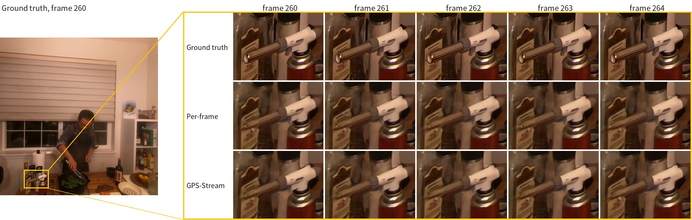

# Tile-wise streaming inference and TensorRT

GPS-Stream runs GPS-Gaussian+ (rectified stereo pair → one 3D Gaussian per pixel) on video without recomputing every frame from scratch:
each frame, only the **128 px tiles that changed** go through depth estimation and Gaussian regression again, with a 4-cell (32 px) context
border around each tile, and those stages run as TensorRT engines. The layers and weight shapes are the original ones; the only new module is
the change selector, STSS.

All numbers are against the ground truth of DyNeRF, 4 scenes (cook_spinach, cut_roasted_beef, flame_steak, sear_steak) × 3 sequences,
start frame 220, evaluated frames 221-299, novel views 2 and 3.

## 1. Results

| Configuration | Computed cells | Valid region PSNR / SSIM / LPIPS | Person box PSNR / SSIM / LPIPS | TensorRT / PyTorch per frame | Weights |
|---|---|---|---|---|---|
| Per-frame (original) | 100% | 29.31 / 0.9236 / 0.0810 | 30.16 / 0.9107 / 0.0714 | 35.0 / 152.4 ms | `gps_plus_dynerf_jit2_final.pth` |
| GPS-Stream | 53.0% | 29.15 / 0.9208 / 0.0839 | 30.15 / 0.9101 / 0.0718 | 29.8 / 118.0 ms | `patch_sparse_ft128h4_rc4` |

Temporal consistency against the ground truth (`data_process/eval_temporal.py`, all consecutive frame pairs of the protocol, lower is better):

| Configuration | tOF (px) | tLP ×100 | Change on static pixels (0-255) |
|---|---|---|---|
| Per-frame (original) | 0.328 | 0.270 | 1.403 |
| GPS-Stream | 0.230 | 0.936 | 0.353 |
| Ground truth itself | | | 1.274 |

- tOF and tLP follow TecoGAN (Chu et al. 2020): the difference between the optical flow (tOF) or the LPIPS distance (tLP) of consecutive rendered frames and the same quantity on the ground truth.
- Static pixels are those where the ground truth changes by less than 3/255 between the two frames; the ground truth's own change there is its sensor noise.
- GPS-Stream changes less between consecutive frames than the per-frame network and than the ground truth itself (consecutive-frame LPIPS ×100 on cook_spinach s2: ground truth 1.48, per-frame 1.24, GPS-Stream 0.72), because tiles without input change are not recomputed. tOF and the static-pixel change count this as less flicker; tLP penalises any deviation from the ground truth's change, including too little change, which is why it is higher for GPS-Stream.

- Quality is from the TensorRT execution; the PyTorch execution with the same weights differs by at most 0.01 dB PSNR.
- Computed cells = summed crop area (tiles + context border) / area of the 1/8 cell map, averaged over the timing segment; the updated tiles
  themselves cover 23.5% there and 20.5% over the full protocol.
- Times exclude rendering (+6.6-7.0 ms); stage profile in section 5.

## 2. What differs from the original (`lib/patch_sparse.py`)

| Part | Original per-frame | GPS-Stream |
|---|---|---|
| Frames | every frame independently, whole frame | only the start frame is computed whole, by the original network. Later frames recompute the updated tiles and keep stored values elsewhere; intermediate maps are carried to the next frame as state |
| Change detection | none | STSS (about 10k parameters) compares the current 1/8 features with the features of the frame where each cell was last updated (5×5 neighbourhood similarity and difference) and marks changed cells. The 128 px tiles (16×16 cells) containing them are updated, per view |
| Epipolar attention (2 layers) | every cell is a query | only tile cells are queries. Keys / values are the other view's whole row; outside the other view's tiles they are the layer outputs stored at their last update (only the right encoder features seen by the left view in layer 1 are current). Cells outside the tiles are not computed |
| Residual block, context net, GRU × 8, upsampling | convolutions over the whole 1/8 map | one batch of (tile + 4 border cells) crops. The border comes from the stored maps, zero padding beyond the crop; only the tile core is written. The cost volume pairs the crop rows with the other view's whole rows, so the matching range is the original one |
| Normalisation statistics | InstanceNorm / GroupNorm computed over the whole map every frame | the crop stages (residual block, context net, regressor) use the start frame's statistics, per view |
| Gaussian regressor | U-Net over the whole image | (tile + 32 px border) crops. Inputs are current inside the tiles and stored outside; only the tile core is written |
| Output Gaussian maps | new every frame | the previous maps with the tile cores (colour included) overwritten |

- Unchanged: the encoder (whole frame every frame, frozen weights), GRU × 8 from a fresh state and inverse-depth 0.5 start, cost-volume radius, upsampling factor, renderer.
- Because the crops differ from the original's condition, the network is fine-tuned under this condition for 8000 steps. Without it quality drops sharply (PyTorch: 27.96 dB untrained, 29.17 dB trained).

## 3. TensorRT

All engines are fp16 (TensorRT 10.13, ONNX opset 17) and are written to `experiments/gps_plus_dynerf_jit2_1007/trt/<folder>/<name>_fp16.engine`.

| Engine | Computes | Batch | Built by |
|---|---|---|---|
| `sparse/enc` | encoder, both views, whole image; original weights | fixed 2 | `bench_trt_sparse.py --build --only enc` |
| `front_crop24` | attention residual block + context net on 24×24-cell crops | dynamic 1-96 | `build_sparse_trt.py` |
| `gru_crop24` | cost-volume lookup + GRU × 8 + convex upsampling on crops | dynamic 1-96 | `build_sparse_trt.py` |
| `regr_crop192` | Gaussian regressor on 192×192 px crops | dynamic 1-96 | `build_sparse_trt.py` |
| `att_rows_l0`, `att_rows_l1` | epipolar attention layers 1 and 2, rows that contain tile cells | dynamic 1-128 rows | `build_sparse_trt.py` |
| `source_net_f3_it8` (directly under `trt/`) | the whole per-frame network (reference time) | fixed | `export_trt_patch.py` |

The runner is `lib/patch_sparse_trt.py` (`PatchSparseTRT`); the engine wrapper is `TrtNet` in `lib/trt_sparse.py`.

Design decisions:
- **Normalisation statistics are an engine input.** The start-frame statistics differ per sequence, so they are not baked in as constants. Each crop gets its view's [scale | offset] vector (`aff`) and every normalisation layer slices its own channels (`fold_input_affine`, `affine_vectors`).
- **Dynamic batch.** The number of tiles changes every frame, so the crop engines take a dynamic batch (optimised for 32, at most 96); more than 96 crops run in chunks.
- **Attention as row engines.** The rows that contain tile cells are batched and the results scattered back to the cells. With PyTorch attention instead, quality is the same and the frame takes about 3 ms longer.

Problems met and fixes:
- `TrtNet` copies inputs with `.contiguous()`; releasing a copy before the engine ran let the memory be reused and corrupted results. The copies are held until execution.
- Caching output buffers per input shape made memory grow without bound, since the batch size changes every frame. Outputs are allocated per call.
- `nn.MultiheadAttention` exports with a fixed batch, and torch 2.0's `scaled_dot_product_attention` does not export. Attention is exported from a module that writes the math out (`RowAttn`).
- Buffers and constant tensors created inside export modules (coordinate grids etc.) are moved to the GPU before export.
- Building engines while evaluations run exhausts GPU memory; build first.

## 4. Running

Commands for data, training, engines, timing and evaluation: [training.md](training.md).

## 5. Stage profile

One session with the GPU alone (`bench_trt_sparse.py --time` for the per-frame network,
`bench_patch_sparse_trt.py` for GPS-Stream), cook_spinach s2 frames 221-260, per frame, rendering excluded.

| Stage | Per-frame TensorRT | GPS-Stream TensorRT | Per-frame PyTorch | GPS-Stream PyTorch |
|---|---|---|---|---|
| Encoder (whole image, both views) | 4.3 ms | 4.9 ms | 17.6 ms | 18.1 ms |
| Change selection (STSS) | — | 2.2 ms | — | 2.1 ms |
| Epipolar attention, residual block, context net | 4.3 ms | 5.5 ms (attention 3.5 + crops 2.0) | 12.7 ms | 13.1 ms (attention + residual 8.5, context net 4.6) |
| GRU × 8 and upsampling | 9.9 ms | 6.0 ms | 49.3 ms | 38.9 ms |
| Gaussian regressor | 16.9 ms | 10.9 ms | 68.6 ms | 45.4 ms |
| Total | 35.5 ms (one engine: 35.0) | 29.8 ms | 148.3 ms (whole recipe: 152.4) | 118.0 ms |

- Per-frame stage times are the stages of the same network as separate engines / modules, timed alone on prepared inputs. GPS-Stream stage
  times are measured inside its complete per-frame pipeline, so they include the crop gathers, the write-back and one synchronisation per stage.
- The GRU and the regressor run on crops that cover 53% of the 1/8 map (tiles plus border) and take 61% and 64% of their per-frame time.
  Attention, residual block and context net are cheap in both; for GPS-Stream they add the row gathers and the crop write-back.
  The encoder runs on the whole frame in both, because STSS needs its features.

## 6. Timing protocol

- GPU with no other work, cook_spinach s2 frames 221-260, state carried from frame to frame.
- Each frame's complete pipeline (encoder → STSS → attention → crop stages → tile write-back) is timed between `torch.cuda.synchronize()` calls; the first two frames are dropped from the average.
- Rendering and data loading are excluded; rendering alone takes 6.6-7.0 ms.
- `bench_patch_sparse_trt.py` times the TensorRT and PyTorch executions of the same weights in one script. The per-frame row is `bench_trt_sparse.py --time` (the single engine, and the whole PyTorch recipe).

## 7. Files

| File | Role |
|---|---|
| `lib/temporal_gps.py` | wrapper of the original network (inputs, per-frame recipe, Gaussian regression, depth conversion) and STSS |
| `lib/patch_step3.py` | STSS cells → tile footprint |
| `lib/temporal_patch.py`, `lib/temporal_sparse.py` | tile indices, crops and write-back; frozen InstanceNorm / GroupNorm statistics (`FrozenNorm`) |
| `lib/frozen_norm.py` | frozen GroupNorm statistics of the regressor (per view of each crop) |
| `lib/patch_sparse.py` | PyTorch execution |
| `lib/patch_sparse_trt.py` | the same execution with TensorRT |
| `lib/trt_sparse.py` | export modules, engine build, `TrtNet` |
| `lib/patch_trt.py`, `export_trt.py`, `export_trt_patch.py` | whole per-frame network as one engine (reference), shared export helpers |
| `lib/temporal_loader.py` | clip dataset for training |
| `train_stss_patch.py` | STSS training inside the patch pipeline |
| `train_patch_sparse.py` | fine-tuning under the tile execution condition |
| `build_sparse_trt.py` | crop and attention engines |
| `bench_patch_sparse_trt.py`, `bench_trt_sparse.py` | per-frame time (TensorRT, PyTorch), encoder engine build, per-frame engine time |
| `test_patch3.py` | full-protocol renders (`--exec sparse_trt` / `sparse` / `perframe` / `trt_full`) |
| `data_process/eval_metrics.py` | PSNR / SSIM / LPIPS against the ground truth (valid region, person box) |
| `data_process/eval_temporal.py` | temporal consistency against the ground truth (tOF, tLP, static-region flicker) |

`train_patch_sparse.py` and the evaluation / timing scripts import `train_temporal.py` (`to_cuda`) and `train_patch3.py` (`chamfer`, `TEACHER`).

## 8. Environment

Python 3.10.13, PyTorch 2.0.1 (CUDA 11.8), TensorRT 10.13.0.35 (Python), ONNX 1.23.2, RTX 3090 (driver 580).
Weights, engines and renders live under `experiments/` and are not part of the repository.
